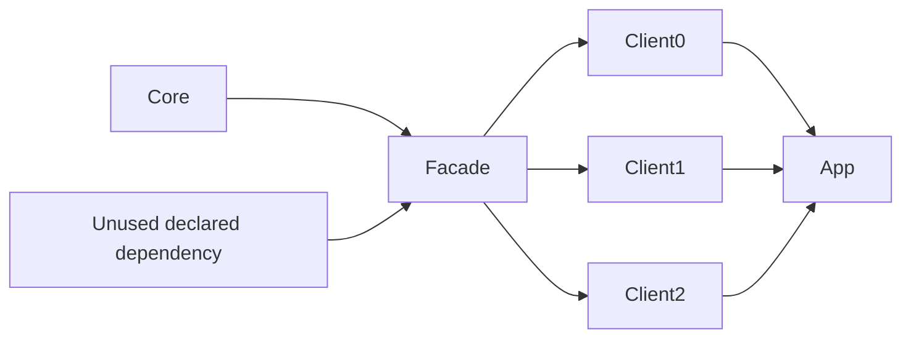

# Incremental edit matrix

The single-library benchmark measures compiler latency after a comment edit.
This suite measures how edits propagate across a dependency graph, including
changes that affect bytecode without changing source-level method signatures.



Arrows point from dependency to consumer. Core has 20 source files by default;
Facade, Spare, each client, and App have one. Java and Kotlin use equivalent
separate graphs. Every build requests **all runtime jars**, so ABI modes cannot
appear faster merely by building dependency headers and omitting runtime code.

| Edit | What changes | API boundary |
| --- | --- | --- |
| `no_op` | Nothing | Control for Bazel/logging overhead; must execute no full compilers |
| `comment` | One Core file's comment | No ABI or runtime behavior change |
| `body` | One Core method body | Behavior changes, signature stays fixed |
| `private_member` | Private method added to Core | No public Core API change |
| `internal_module_api` | Public method added to Core | Internal dependency API changes; Facade's exposed methods stay fixed |
| `public_module_api` | Public method added to Facade | API seen by all clients changes |
| `multi_file_body` | Three Core files' bodies | Several dirty files within one target, no public API change |
| `multi_module_body` | Core and Facade bodies | Two dirty targets, no public API change |
| `multi_module_api` | Public methods added to Core and Facade | Two targets' APIs change |
| `unused_dependency_api` | Public method added to Spare | Tests pruning of a declared but unused dependency |
| `inline_or_constant` | Java constant or Kotlin inline body in Core | Signatures stay fixed, but callers must observe changed compile-time code |

API edits are additive, keeping every graph compilable. This does not model a
breaking signature migration that also needs consumer source changes. The
internal/public module distinction is defined by the Facade boundary; it does
not imply Java JPMS enforcement or that Bazel will automatically hide transitive
classpath changes. The action logs reveal how far changes actually propagate.

[Recorded results](INCREMENTAL_RESULTS.md) include all 99 cases and the slower paths,
with structured sample data retained in the repository. A subsequent
[combined ABI comparison](FUSED_ABI_RESULTS.md) covers all 121 cases with the new
Kotlin modes.

## Modes

- `vanilla`: stock `java_library` / `kt_jvm_library` with their default ABI behavior.
- `vanilla_abi`: stock Kotlin with its opt-in `--define=experimental_use_abi_jars=1`.
  This compares optimized Elide against a stock ABI-enabled baseline as well as
  stock defaults. Java already uses headers by default, so this mode is Kotlin-only.
- `elide`: native Elide rules, default worker mode and flags.
- `elide_abi`: Elide with language-specific `abi_compile_avoidance=true`.
- `elide_pruned`: ABI mode plus dependency reporting and unused-input pruning.
- `elide_fused`: language-specific ABI mode with `abi_from_compile=true`; emits full and
  header jars in one compiler action. Consumers wait for that action to finish.
- `elide_fused_pruned`: Java/Kotlin combined emission plus unused-input pruning.
- `elide_incremental`: Kotlin only, ABI mode plus experimental per-target
  incremental compilation. Pruning is deliberately off because IC is an opaque
  compile path. Compiler-action counts cannot show how many files IC recompiles
  inside one action.

These are native Elide rules, not the rules_kotlin KotlinBuilder adapter.
Mixed-language modules, processors, resource edits, dependency upgrades,
parallel fan-out scaling, and remote execution need separate experiments.

## Run and interpret

```sh
python3 benchmarks/incremental_matrix.py --sources 20 --fanout 3 --rounds 3
# Focused run; --distdir may be repeated to reuse downloaded distributions:
python3 benchmarks/incremental_matrix.py --languages kotlin \
  --modes vanilla elide_abi elide_pruned --scenarios body public_module_api
```

The **Incremental benchmarks** workflow runs the complete matrix on demand and
uploads `incremental-benchmark-results`. Results contain a Markdown table,
structured JSON with every measured sample, full compiler targets, ABI/header
targets, mnemonic counts, and raw Bazel execution logs. Failed builds fail the
benchmark; an edit that compiles no runtime target also fails validation.

The suite uses a temporary workspace/output base and shuts it down on exit.
Shared action caches and remote execution are disabled. Before **each** edit it
restores and rebuilds the pristine graph outside timing. It discards warm-up
rounds and reports means, medians, and sample standard deviations. Times include
Bazel invocation, analysis, and execution-log overhead; use the no-op control to
understand the floor. Do not subtract noisy no-op samples to claim compiler-only
performance. Hosted runners and sequential mode ordering introduce noise; repeat
runs before treating small differences as regressions.

Outputs default to `benchmarks/results/incremental/` (ignored by Git).
Use a different `--output` directory to retain multiple runs. These measurements
show recompilation behavior, not a proof of ABI soundness; runtime-result and
cache-invalidation tests remain necessary.

The workflow's `language` input selects `both`, `java`, or `kotlin`. This allows
focused comparisons without rerunning the other language. Java now includes
combined-emission modes; a full default run contains 154 cases and 462 measured
samples. Earlier recorded reports retain their original mode counts.

## Critical-path and memory traces

Pass `--profiles` to retain a compressed Bazel trace for every measured/warm-up
build and summarize it in JSON and Markdown. The workflow exposes a matching
`profiles` boolean. Each mode now starts with a fresh Bazel server and worker
pool; dependency fetching, baseline builds, and warm-ups remain outside timing.
This prevents workers from another mode contaminating memory counters. Historical
reports without `isolated_mode_servers` used shared server lifetimes across modes.

The trace summary records critical-path action time, its elapsed span (including
gaps), maximum recorded worker memory, worker memory by mnemonic, and Bazel's
heap-plus-non-heap usage. Memory is in MiB, following Bazel's counter definitions.
These are sampled, complete bucket averages, **not process peak RSS**. Bazel
uses one-second buckets; a partial tail can substantially understate memory on
short builds. A series contributes a bucket only when a later positive bucket
proves sampling crossed its boundary. Otherwise memory remains unknown. Short builds can
miss transient peaks; worker counters exclude non-worker compiler processes, and
Bazel's memory counter excludes native process overhead. Missing counters are
`null`/`n/a`, never treated as a zero-memory win. The sum of separate per-mnemonic
maxima need not equal the observed total maximum.

Compare profiled runs against each other. The original unprofiled wall-clock
reports remain useful, but trace collection and server isolation are methodology
changes. Raw traces can be inspected in a Chrome trace viewer to locate worker,
classpath, and scheduling overhead before choosing another optimization.

Run the trace interpretation tests with:

```sh
python3 -m unittest discover -s benchmarks -p '*_test.py'
```

The report records whether tracked workspace changes were present. Local experiments
with uncommitted changes must not be attributed solely to the recorded HEAD commit.
Earlier comparisons used stock Kotlin defaults; the new `vanilla_abi` mode is needed
before claiming superiority over stock Kotlin's optional ABI configuration.
