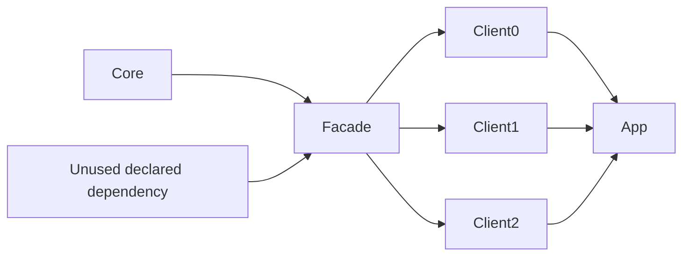

# Incremental edit matrix

The single-library benchmark measures compiler latency after a comment edit.
This suite measures how edits propagate across a dependency graph, including
changes that affect bytecode without changing source-level method signatures.



Arrows point from dependency to consumer. Core has 20 source files by default;
Facade, Spare, each client, and App have one. Java and Kotlin use equivalent
separate graphs. Every build requests **all runtime jars**, so ABI modes cannot
appear faster merely by building dependency headers and omitting runtime code.

| Edit | What changes | API boundary |
| --- | --- | --- |
| `no_op` | Nothing | Control for Bazel/logging overhead; must execute no full compilers |
| `comment` | One Core file's comment | No ABI or runtime behavior change |
| `body` | One Core method body | Behavior changes, signature stays fixed |
| `private_member` | Private method added to Core | No public Core API change |
| `internal_module_api` | Public method added to Core | Internal dependency API changes; Facade's exposed methods stay fixed |
| `public_module_api` | Public method added to Facade | API seen by all clients changes |
| `multi_file_body` | Three Core files' bodies | Several dirty files within one target, no public API change |
| `multi_module_body` | Core and Facade bodies | Two dirty targets, no public API change |
| `multi_module_api` | Public methods added to Core and Facade | Two targets' APIs change |
| `unused_dependency_api` | Public method added to Spare | Tests pruning of a declared but unused dependency |
| `inline_or_constant` | Java constant or Kotlin inline body in Core | Signatures stay fixed, but callers must observe changed compile-time code |

API edits are additive, keeping every graph compilable. This does not model a
breaking signature migration that also needs consumer source changes. The
internal/public module distinction is defined by the Facade boundary; it does
not imply Java JPMS enforcement or that Bazel will automatically hide transitive
classpath changes. The action logs reveal how far changes actually propagate.

## Modes

- `vanilla`: stock `java_library` / `kt_jvm_library` with their default ABI behavior.
- `elide`: native Elide rules, default worker mode and flags.
- `elide_abi`: Elide with language-specific `abi_compile_avoidance=true`.
- `elide_pruned`: ABI mode plus dependency reporting and unused-input pruning.
- `elide_incremental`: Kotlin only, ABI mode plus experimental per-target
  incremental compilation. Pruning is deliberately off because IC is an opaque
  compile path. Compiler-action counts cannot show how many files IC recompiles
  inside one action.

These are native Elide rules, not the rules_kotlin KotlinBuilder adapter.
Mixed-language modules, processors, resource edits, dependency upgrades,
parallel fan-out scaling, and remote execution need separate experiments.

## Run and interpret

```sh
python3 benchmarks/incremental_matrix.py --sources 20 --fanout 3 --rounds 3
# Focused run; --distdir may be repeated to reuse downloaded distributions:
python3 benchmarks/incremental_matrix.py --languages kotlin \
  --modes vanilla elide_abi elide_pruned --scenarios body public_module_api
```

The **Incremental benchmarks** workflow runs the complete matrix on demand and
uploads `incremental-benchmark-results`. Results contain a Markdown table,
structured JSON with every measured sample, full compiler targets, ABI/header
targets, mnemonic counts, and raw Bazel execution logs. Failed builds fail the
benchmark; an edit that compiles no runtime target also fails validation.

The suite uses a temporary workspace/output base and shuts it down on exit.
Shared action caches and remote execution are disabled. Before **each** edit it
restores and rebuilds the pristine graph outside timing. It discards warm-up
rounds and reports means, medians, and sample standard deviations. Times include
Bazel invocation, analysis, and execution-log overhead; use the no-op control to
understand the floor. Do not subtract noisy no-op samples to claim compiler-only
performance. Hosted runners and sequential mode ordering introduce noise; repeat
runs before treating small differences as regressions.

Outputs default to `benchmarks/results/incremental/` (ignored by Git).
Use a different `--output` directory to retain multiple runs. These measurements
show recompilation behavior, not a proof of ABI soundness; runtime-result and
cache-invalidation tests remain necessary.
