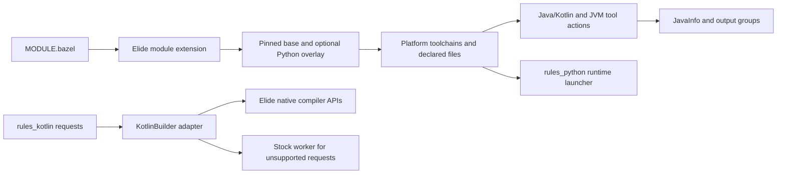

# Architecture

rules_elide integrates Elide distributions with Bazel's repository, toolchain,
action, provider, and runfiles APIs. It contains Starlark rules and a Kotlin
worker adapter; it does not implement the underlying language compilers.

| Component | Implementation | Contract |
| --- | --- | --- |
| Distribution selection | `elide/extensions.bzl`, `elide/private/versions.bzl`, `download.bzl`, `hub.bzl` | Resolve a selected version; verify platform hashes; overlay matching Python components |
| Toolchain | `elide/toolchain.bzl`, `providers.bzl` | Expose the binary and distinct compile/native-image/Python file sets |
| Java/Kotlin rules | `elide/rules/java.bzl`, `kotlin.bzl`, `elide/private/compile_common.bzl` | Declare actions and classpaths; return JavaInfo; handle workers, ABI jars, resources, and reports |
| JVM tools and processing | `elide/rules/jvm_tools.bzl`, `processing.bzl` | Declare tool inputs and outputs for docs, archives, inspection, bindings, KAPT, and KSP |
| KotlinBuilder adapter | `elide/kotlin/toolchain.bzl`, `elide/kotlin/builder/` | Parse rules_kotlin requests; preserve worker protocol; route supported requests to native APIs or legacy fallback |
| Python adapter | `elide/python/toolchain.bzl`, `launcher.sh.tpl` | Register a target-platform Python runtime with runfiles and controlled interpreter startup |
| Public API/docs | `elide/defs.bzl`, `docs/BUILD.bazel` | Keep exports and generated references synchronized |

Compiler tools execute on the **execution platform**. Python binaries use a
runtime for the **target platform**. Do not replace either with host-machine
interpreter or JDK discovery.

ABI jars are downstream compile inputs; full jars remain runtime outputs.
Unused-input reports may remove dependencies from future action keys, so both
conservative classification and rebuild behavior matter. Processor/plugin and
incremental paths deliberately retain inputs when their reads cannot be safely
inferred from class usage.

See [testing](testing.md) for contract and execution coverage and
[the security model](security-model.md) for trust boundaries.
